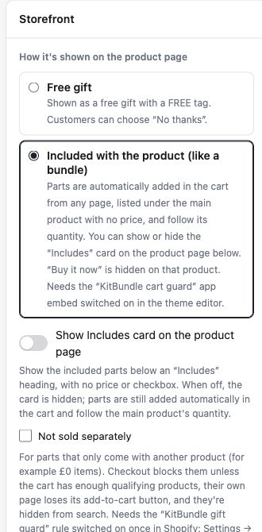

# Included 产品页卡片显示开关

日期：2026-11-21。状态：用户确认后已发布 kitbundle-132；正式页面交互待验收。

## 使用方式

Free gifts → 编辑活动 → Storefront → 选择 **Included with the product (like a bundle)**，
在下面打开 / 关闭 **Show Includes card on the product page**，再保存活动。

- 默认开启，现有活动继续显示 Includes 卡片。
- 关闭仅隐藏此活动的产品页卡片；自动带部件、按主品数量同步、主品删除联动、
  不单卖标记、结账规则和款式 / 优先级限制不变。
- 只在 Included 模式下显示开关；普通赠品仍保留选择和 No thanks。
- 复制活动保留开关选择，修改记录会记录显示 / 隐藏。

## 实现范围

- `GiftCampaign.showIncludedCard`：数据库 Boolean，默认 true；新增迁移
  `20261121000000_included_card_visibility`。
- 活动读写、默认值、复制流程、修改历史与同步引擎贯通。
- 只在 Included 卡片关闭时向产品标记写入 `showIncludedCard:false`；
  原有未配置字段的标记继续显示，也避免默认情况下触发不必要的全店标记更新。
- 产品页先按原有有效期 / 款式 / 优先级规则计算活动，再过滤隐藏的 Includes 卡片。
  隐藏活动不从规则源中移除，因此不会放出被它排除的其它活动，也不会影响部件加入购物车。
- `cart-guard.js`、折扣和结账 Function、正式主题均未修改。

## 本地验证

- `node node_modules/vitest/vitest.mjs run --config vitest.config.mts`：25/25。
  覆盖保存 / 重新读取 / 开启恢复 / 复制草稿 / 旧数据默认值、产品标记同步以及修改历史。
- `node tests/cart-guard-gifts.sim.mjs`：14/14。
  包含隐藏卡片后仍自动带部件、部件不能独立删除、主品数量及删除同步。
- 本地 Chrome 使用真实 `addon-save.js` 和样例产品验证 6/6：
  旧标记显示、开关开启显示、关闭隐藏、关闭时普通赠品仍显示、隐藏独占活动仍抑制其它赠品、
  普通赠品忽略 Includes 显示字段。
- 真实后台组件预览：只在 Included 模式下出现开关，旧数据默认开启，可以关闭。
- `node --check extensions/addon-block/assets/addon-save.js`、Prisma validate / generate、
  `npm run build`、业务源文件 ESLint、`git diff --check` 通过。
  Prisma 校验和生成使用命令级的本地假数据库地址，没有连接正式数据库。
- 构建有既有 Polaris CSS 媒体查询警告；不影响构建结果。
- 测试文件的 ESLint 配置会按 Jest 加载 Vitest 文件并报找不到 Jest；单独关闭该检查后，
  既有 `engine.test.ts` / `history.test.ts` 还会触发原有 mock 后 import 的 `import/first`。
  本次未修改全局 lint 配置；新增测试文件调整为顶部 import 后单独检查通过。

## 正式发布记录

用户于本对话明确同意发布后执行：

- 代码 `04850588817590f75cdb568ba4050ea1b7ad49e4` 已推送 main。
- Railway Kitbundle / production / addon-discount 部署
  `f2af1849-454a-4be3-9e2f-d4dcc797087e` 状态 SUCCESS。
- 2026-11-21 10:16:06（Asia/Shanghai），部署日志确认
  `20261121000000_included_card_visibility` 迁移成功；10:16:07 服务和赠品定时器启动。
- Shopify `kitbundle-132` 于 10:19:02 发布，版本列表二次确认 active；版本 ID `1260097208321`。
- 未保存或关闭正式活动，未改正式主题、购物车或商品设置。
- 正式页面交互验收未完成：浏览器连接多次超时，切换原生界面后又被用户操作打断；
  普通 HTTP 获取产品页返回 429，未取得线上 CDN 脚本指纹。
  因此没有把开关保存 / 产品页显隐 / 实际加购标为本次线上实测通过。
  额外的正式库只读字段检查也未建立成功连接；迁移成功以 Railway 部署日志为依据。

## 发布范围与恢复

本次同时更新 Railway 后台（含上述新增字段的迁移）和 Shopify 前台扩展。
发布顺序为先完成数据库 / 后台更新，再发布前台扩展。现有活动的新字段默认 true，无需批量改活动。
后续验收在活动编辑页核对开关保存、产品页显示及购物车联动。

未推主题，也未改折扣 / gift-guard 的逻辑；未替用户关闭截图中的正式活动。
如果上线后只需恢复卡片，在该活动打开开关并保存即可。

需回退前台扩展时可发布旧版 `shopify app release --version kitbundle-131`；这不会自动回退 Railway 后台。
新增数据库字段可保留，勿为回退直接删除字段或迁移记录。
